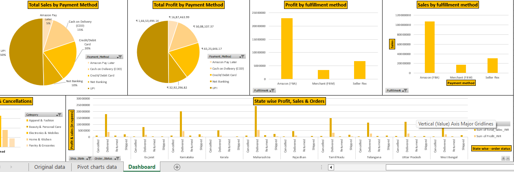
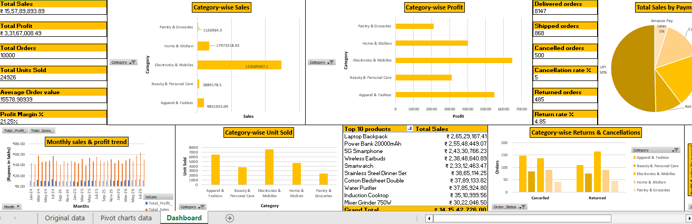
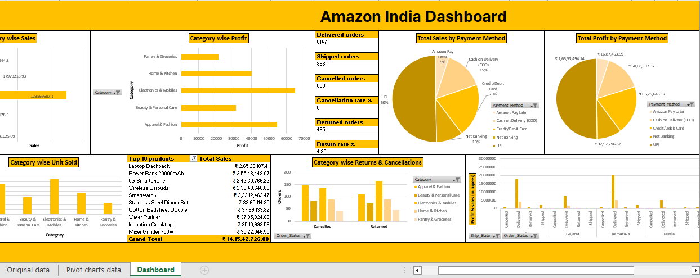

# Amazon-India-Sales-Dashboard

## Project Overview

This project focuses on analyzing Amazon India sales data to develop a consolidated business dashboard that provides a clear overview of overall business performance.

The dashboard is designed for non-technical business managers to monitor sales, profitability, product performance, order status, payment methods, fulfilment channels, and geographic performance in one place.

## Business Objective

To transform sales data into meaningful business insights through interactive visualizations and key performance indicators (KPIs), enabling management to monitor performance, identify potential issues, and make informed business decisions.

## Business Questions

### 1. Overall Sales & Profit Performance
- What are the total sales and total profit?
- How many orders and units have been sold?
- What is the average order value (AOV)?
- What is the overall profit margin?
- How are sales and profit trending over time?

### 2. Category & Product Performance
- Which product categories generate the highest sales and profit?
- Which categories sell the most units?
- Which are the top 10 products by sales?
- Which products or categories may require attention?

### 3. Order Status & Revenue Loss
- How many orders are delivered, shipped, returned, or cancelled?
- What are the return and cancellation rates?
- Which categories have the highest returns and cancellations?
- How do order issues affect business performance?

### 4. Payment, Fulfilment & Geographic Performance
- Which payment methods generate the most sales and profit?
- Which fulfilment methods perform best?
- Which states contribute the most sales, profit, and orders?

## Dashboard Preview

The consolidated dashboard brings together key business metrics and visualizations in a single view.

![Amazon India Sales Dashboard]

Dashboard Preview 1

Dashboard Preview 2

Dashboard Preview 3

## Key Performance Indicators (KPIs)

- Total Sales
- Total Profit
- Total Orders
- Total Units Sold
- Average Order Value (AOV)
- Profit Margin (%)
- Return Rate (%)
- Cancellation Rate (%)

## Tools & Skills

- Power BI
- Data Analysis and Visualization
- Data Transformation
- KPI Development
- Business Intelligence
- Sales and Profitability Analysis
- Business Performance Monitoring

## Key Insights

Insights will be documented after reviewing the dashboard results, including sales and profit trends, top-performing categories, order returns and cancellations, payment preferences, fulfilment performance, and geographic sales distribution.

